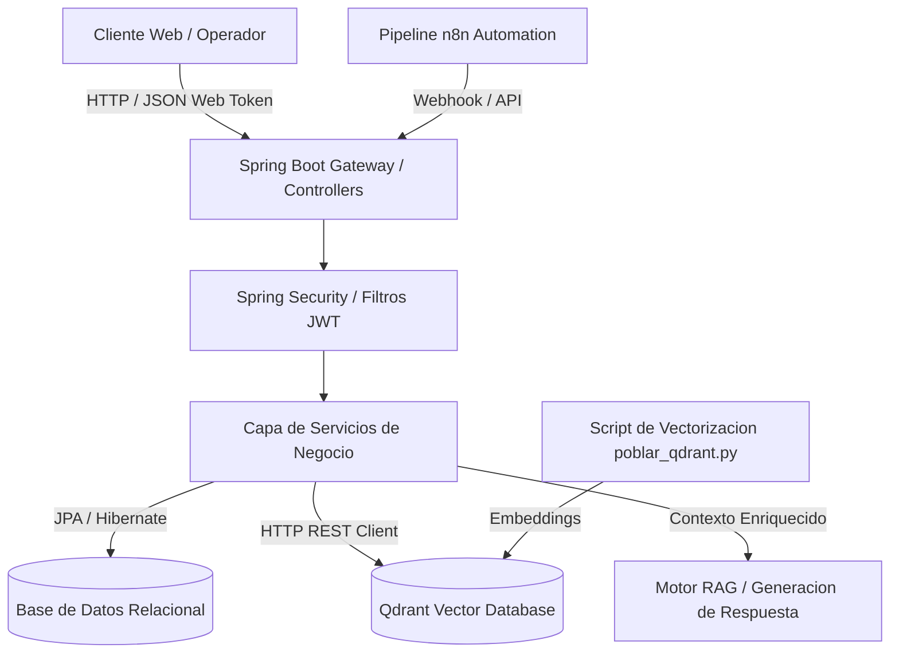

# Inventra RAG - Plataforma de Gestion de Inventarios con Recuperacion Aumentada por Generacion

Sistema empresarial de control de inventarios, gestion de almacenes y busqueda semantica inteligente asistida por modelos de lenguaje y bases de datos vectoriales.

[]()
[]()
[]()
[]()
[]()

## Resumen Ejecutivo

La administracion de almacenes e inventarios a gran escala enfrenta comunmente desafios asociados a la dispersión de datos tecnicos, discrepancias en nomenclaturas y lentitud en la identificacion de articulos similares o equivalentes. Inventra RAG transforma la experiencia operativa integrando una arquitectura de backend robusta en Spring Boot con una base de datos vectorial Qdrant y flujos de automatizacion en n8n, permitiendo consultas en lenguaje natural mediante tecnicas RAG (Retrieval-Augmented Generation).

## Alcance y Objetivos de Negocio

- Control transaccional de existencias, categorias, almacenes y movimientos fisicos de mercancia.
- Busqueda semantica y recuperacion contextual de productos a partir de consultas ambiguas o descripciones funcionales.
- Seguridad perimetral con autenticacion basada en JSON Web Tokens (JWT) y control de acceso basado en roles (RBAC).
- Orquestacion de flujos de notificacion automatica ante caidas en puntos de reorden y pedidos de abastecimiento.
- Interoperabilidad completa a traves de una API REST documentada bajo el estandar OpenAPI 3.

## Arquitectura del Sistema

Inventra RAG sigue un enfoque arquitectonico desacoplado y orientado a servicios:
1. Nucleo Backend (Spring Boot 4.1, Spring Data JPA, Spring Security).
2. Capa de Base de Datos Relacional y Vectorial (MySQL / PostgreSQL para persistencia transaccional y Qdrant para indices vectoriales).
3. Capa de Orquestacion RAG (n8n para automatizacion de pipelines y poblamiento de embeddings).
4. Capa Frontend Administrativa (Cliente web para operadores y jefes de inventario).

### Diagrama de Flujo Arquitectonico



### Estructura de Directorios

```text
Inventra-Rag-Proyecto/
├── .env.example             # Plantilla de configuracion de variables de entorno
├── .gitignore               # Reglas de exclusion de control de versiones
├── poblar_qdrant.py         # Script utilitario de generacion e indexacion de embeddings
├── workflow.json            # Definicion exportable del flujo de orquestacion n8n
├── backend/                 # Modulo de servicios y logica empresarial en Java
│   ├── build.gradle         # Gestion de dependencias y plugins de Gradle
│   ├── gradlew              # Wrapper de ejecucion Gradle para entornos Unix
│   ├── gradlew.bat          # Wrapper de ejecucion Gradle para Windows
│   └── src/main/java/...    # Controladores, servicios, modelos y seguridad Spring Boot
└── frontend/                # Interfaces graficas y componentes de administracion
```

## Stack Tecnologico

El sistema combina una infraestructura de persistencia mixta y una logica transaccional tipada y confiable.

### Backend y Persistencia

-  Entorno de ejecucion backend con Java 25.
-  Framework empresarial para microservicios y APIs REST.
-  Marco de seguridad, autorizacion y proteccion de recursos.
-  Sistema de construccion y gestion declarativa de dependencias.
-  Mecanismo de sesiones sin estado e intercambio seguro de identidades.
-  Motor vectorial para almacenamiento de embeddings y busqueda por similitud de coseno.

### Frontend y Automatizacion

-  Motor de orquestacion de flujos y pipelines de datos asincronos.
-  Scripts de soporte para procesamiento matricial y preparacion de colecciones vectoriales.
-  Dinamismo del panel administrativo del cliente web.
-  Formatos estandar de interfaz para gestion de existencias.
-  Estilos y diseno responsivo para terminales moviles y de escritorio.

### Integraciones y Servicios de Inteligencia Aumentada

- **SpringDoc OpenAPI**: Generacion automatica de documentacion Swagger para validacion de endpoints.
- **Colecciones Qdrant**: Indexacion de descripciones de productos con distancia coseno para recuperacion precisa.
- **Workflows n8n**: Disparo de webhooks de alerta cuando los inventarios alcanzan umbrales minimos criticos.

## Requisitos Previos del Sistema

- Java Development Kit (JDK): Version 21 o 25 instalada y configurada en `JAVA_HOME`.
- Python: Version 3.9 o superior (para ejecucion del script de vectorizacion `poblar_qdrant.py`).
- Instancia de Qdrant: Ejecutandose localmente via Docker o accesible en la nube (puerto por defecto 6333).
- Motor de Base de Datos: MySQL 8+ o PostgreSQL 14+.
- Memoria RAM: Minimo 8 GB (recomendado 16 GB si se ejecutan microservicios y contenedor Qdrant en local).

### Variables de Entorno y Configuracion

Configurar el archivo `.env` en la raiz o en el modulo `backend/` a partir de `.env.example`:

| Variable | Descripcion | Valor Ejemplo |
| :--- | :--- | :--- |
| `SERVER_PORT` | Puerto de escucha de la aplicacion Spring Boot | `8080` |
| `DB_URL` | Cadena JDBC de conexion a la base de datos | `jdbc:postgresql://localhost:5432/inventra_db` |
| `DB_USERNAME` | Usuario administrador de la base de datos | `inventra_user` |
| `DB_PASSWORD` | Credencial secreta de acceso a datos | `secret_password` |
| `JWT_SECRET` | Clave simetrica HMAC-SHA256 para firma de tokens | `5367566B59703373367639792F423F45...` |
| `JWT_EXPIRATION` | Tiempo de vida del token en milisegundos | `86400000` (24 horas) |
| `QDRANT_HOST` | Host del motor de base de datos vectorial | `http://localhost:6333` |

## Guia de Instalacion y Despliegue Local

1. Clonar el repositorio:
```bash
git clone https://github.com/SantiSarmiento11/Inventra-Rag-Proyecto.git
cd Inventra-Rag-Proyecto
```

2. Levantar la instancia de Qdrant mediante Docker:
```bash
docker run -p 6333:6333 -p 6334:6334 -v $(pwd)/qdrant_storage:/qdrant/storage:z qdrant/qdrant
```

### Compilacion y Construccion del Backend

Ingresar al directorio `backend/` y compilar el proyecto utilizando el wrapper de Gradle:
```bash
cd backend
# En Linux / macOS:
./gradlew clean build -x test
# En Windows:
gradlew.bat clean build -x test
```

### Ejecucion del Sistema

Iniciar la aplicacion Spring Boot:
```bash
./gradlew bootRun
```

Acceder a los puntos de enlace:
- Servicio Backend: `http://localhost:8080`
- Documentacion Swagger UI: `http://localhost:8080/swagger-ui.html`
- OpenAPI JSON: `http://localhost:8080/v3/api-docs`

## Funcionamiento del Sistema

El sistema opera bajo un flujo estructurado de gestion y recuperacion inteligente:
1. Inicializacion y comprobacion de tablas y roles basicos (`ROLE_ADMIN`, `ROLE_OPERADOR`, `ROLE_AUDITOR`) mediante `DataInitializer`.
2. Autenticacion del operador y emision de token portador (Bearer JWT).
3. Operaciones de alta, actualizacion y movimiento de stock a traves de endpoints protegidos.
4. Poblamiento y actualizacion de indices vectoriales al detectar mutaciones en los registros de inventario.
5. Evaluacion de consultas semanticas complejas via embeddings y proyeccion RAG.

### Flujo de Interaccion de Usuario

- **Inicio de Sesion**: El usuario ingresa credenciales en `/api/auth/login` y recibe su sesion segura.
- **Panel de Control**: Visualizacion de metricas clave, inventario critico y graficas de rotacion de stock.
- **Catalogo de Productos**: Busqueda tradicional por codigo SKU y busqueda semantica mediante descripciones aproximadas.
- **Modulo de Permisos y Roles**: Administracion granular de accesos por usuario.

### Pipeline de Datos y Vectorizacion Qdrant

Para cargar o sincronizar el catalogo de productos en la base vectorial:
1. Configurar dependencias de Python:
```bash
pip install qdrant-client sentence-transformers
```
2. Ejecutar el script de poblamiento:
```bash
python poblar_qdrant.py
```
El script genera representaciones vectoriales densas para cada producto e indexa los registros con identificadores unicos.

### Especificacion de Endpoints REST

| Metodo | Ruta | Descripcion | Autorizacion |
| :--- | :--- | :--- | :--- |
| `POST` | `/api/auth/login` | Autenticacion y recepcion de JWT | Publico |
| `GET` | `/api/productos` | Listado paginado de inventario | Autenticado |
| `POST` | `/api/productos` | Creacion de nuevo producto | `ROLE_ADMIN` |
| `GET` | `/api/dashboard/stats` | Metricas y totales de inventario | Autenticado |
| `GET` | `/api/roles` | Listado de roles del sistema | `ROLE_ADMIN` |
| `GET` | `/api/permisos` | Consulta de permisos asignados | `ROLE_ADMIN` |

### Gestion de Errores y Excepciones

Las respuestas de error adoptan el estandar RFC 7807 (Problem Details for HTTP APIs):
```json
{
  "timestamp": "2026-11-11T12:00:00Z",
  "status": 404,
  "error": "Not Found",
  "message": "El producto solicitado con el ID especificado no existe",
  "path": "/api/productos/999"
}
```
Los errores de validacion en formularios retornan un codigo `400 Bad Request` con el desglose exacto de los campos afectados.

## Estrategia de Pruebas y Aseguramiento de Calidad

Se incluyen suites integrales de pruebas de software:
- Pruebas unitarias de servicios de negocio y validacion de reglas de stock negativo.
- Pruebas de integracion con base de datos en memoria (H2 / Testcontainers) para repositorios JPA.
- Pruebas de seguridad verificando que endpoints protegidos rechacen peticiones anonimas con `401 Unauthorized`.

### Comandos de Ejecucion de Pruebas

Ejecutar todas las pruebas del proyecto mediante Gradle:
```bash
cd backend
./gradlew test
```

Generar reporte de cobertura de codigo con JaCoCo:
```bash
./gradlew jacocoTestReport
```

## Monitoreo, Telemetria y Registro de Eventos

Se utiliza Logback estructurado a traves de SLF4J, categorizando logs en niveles `INFO`, `WARN` y `ERROR`. Cada transaccion contiene el ID del operador que realizo la modificacion de inventario, permitiendo un rastro de auditoria inmutable.

## Consideraciones de Seguridad

- Filtro `JwtAuthenticationFilter` que intercepta cada peticion HTTP para validar firma y expiracion del token.
- Contraseñas cifradas mediante algoritmo `BCryptPasswordEncoder` con factor de coste 12.
- Proteccion contra ataques CSRF deshabilitada de manera justificada exclusivamente para endpoints sin estado con tokens portadores (Stateless REST API).

## Despliegue y Puesta en Produccion

Se recomienda el despliegue orquestado mediante Docker Compose o Kubernetes:
- Contenedor Backend: Imagen ligera de OpenJDK Eclipse Temurin.
- Contenedor Base de Datos: Instancia de PostgreSQL con almacenamiento persistente montado.
- Contenedor Qdrant: Cluster de nodos vectoriales con configuracion de persistencia SSD.

## Optimizacion de Rendimiento y Escalabilidad

- Consultas JPA optimizadas con proyecciones y `@EntityGraph` para prevenir el problema de N+1 consultas.
- Pool de conexiones a base de datos gestionado mediante HikariCP con dimensionamiento acorde a la carga concurrente.
- Cache de segundo nivel para productos y categorias de alta rotacion de lectura.

## Matriz de Resolucion de Incidencias

| Sintoma | Causa Frecuente | Procedimiento de Resolucion |
| :--- | :--- | :--- |
| Error de conexion a base de datos al arrancar | Credenciales incorrectas o servicio inactivo | Validar variables `DB_URL`, `DB_USERNAME` y estado del demonio de base de datos. |
| Excepcion de conexion rechazada hacia Qdrant | Contenedor de Qdrant detenido | Verificar con `docker ps` y reiniciar con `docker start <container_id>`. |
| Token JWT rechazado como invalido | Desincronizacion horaria o clave secreta modificada | Comprobar sincronizacion de reloj del sistema y correspondencia de `JWT_SECRET`. |

## Guia de Contribucion

1. Crear un Fork del repositorio.
2. Crear una rama descriptiva (`git checkout -b feature/modulo-alertas`).
3. Confirmar modificaciones siguiendo Conventional Commits (`git commit -m 'feat: adicionar endpoint de alertas de stock'`).
4. Subir la rama y emitir un Pull Request sustentado con pruebas unitarias.

## Autoria y Creditos del Proyecto

Disenado y desarrollado por [Santiago Sarmiento](https://github.com/SantiSarmiento11) como solucion de vanguardia en integracion RAG y gestion de almacenes inteligentes.
