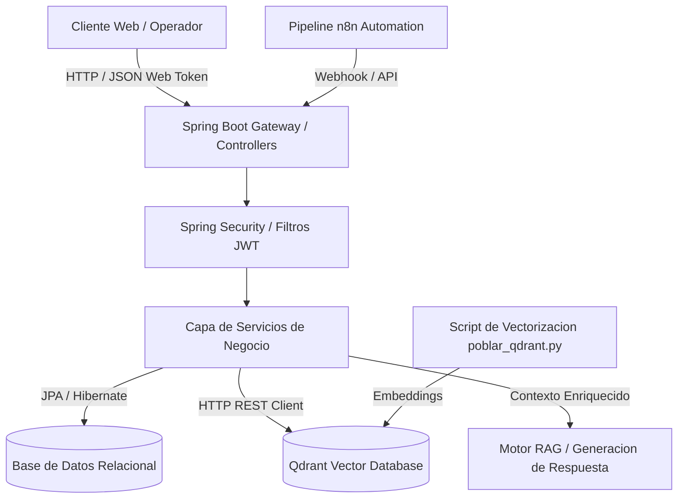

# Inventra RAG - Plataforma de Gestion de Inventarios con Recuperacion Aumentada por Generacion

Sistema empresarial de control de inventarios, gestion de almacenes y busqueda semantica inteligente asistida por modelos de lenguaje y bases de datos vectoriales.

[]()
[]()
[]()
[]()
[]()

## Resumen Ejecutivo

La administracion de almacenes e inventarios a gran escala enfrenta comunmente desafios asociados a la dispersión de datos tecnicos, discrepancias en nomenclaturas y lentitud en la identificacion de articulos similares o equivalentes. Inventra RAG transforma la experiencia operativa integrando una arquitectura de backend robusta en Spring Boot con una base de datos vectorial Qdrant y flujos de automatizacion en n8n, permitiendo consultas en lenguaje natural mediante tecnicas RAG (Retrieval-Augmented Generation).

## Alcance y Objetivos de Negocio

- Control transaccional de existencias, categorias, almacenes y movimientos fisicos de mercancia.
- Busqueda semantica y recuperacion contextual de productos a partir de consultas ambiguas o descripciones funcionales.
- Seguridad perimetral con autenticacion basada en JSON Web Tokens (JWT) y control de acceso basado en roles (RBAC).
- Orquestacion de flujos de notificacion automatica ante caidas en puntos de reorden y pedidos de abastecimiento.
- Interoperabilidad completa a traves de una API REST documentada bajo el estandar OpenAPI 3.

## Arquitectura del Sistema

Inventra RAG sigue un enfoque arquitectonico desacoplado y orientado a servicios:
1. Nucleo Backend (Spring Boot 4.1, Spring Data JPA, Spring Security).
2. Capa de Base de Datos Relacional y Vectorial (MySQL / PostgreSQL para persistencia transaccional y Qdrant para indices vectoriales).
3. Capa de Orquestacion RAG (n8n para automatizacion de pipelines y poblamiento de embeddings).
4. Capa Frontend Administrativa (Cliente web para operadores y jefes de inventario).

### Diagrama de Flujo Arquitectonico



### Estructura de Directorios

```text
Inventra-Rag-Proyecto/
├── .env.example             # Plantilla de configuracion de variables de entorno
├── .gitignore               # Reglas de exclusion de control de versiones
├── poblar_qdrant.py         # Script utilitario de generacion e indexacion de embeddings
├── workflow.json            # Definicion exportable del flujo de orquestacion n8n
├── backend/                 # Modulo de servicios y logica empresarial en Java
│   ├── build.gradle         # Gestion de dependencias y plugins de Gradle
│   ├── gradlew              # Wrapper de ejecucion Gradle para entornos Unix
│   ├── gradlew.bat          # Wrapper de ejecucion Gradle para Windows
│   └── src/main/java/...    # Controladores, servicios, modelos y seguridad Spring Boot
└── frontend/                # Interfaces graficas y componentes de administracion
```

## Stack Tecnologico

El sistema combina una infraestructura de persistencia mixta y una logica transaccional tipada y confiable.

### Backend y Persistencia

-  Entorno de ejecucion backend con Java 25.
-  Framework empresarial para microservicios y APIs REST.
-  Marco de seguridad, autorizacion y proteccion de recursos.
-  Sistema de construccion y gestion declarativa de dependencias.
-  Mecanismo de sesiones sin estado e intercambio seguro de identidades.
-  Motor vectorial para almacenamiento de embeddings y busqueda por similitud de coseno.

### Frontend y Automatizacion

-  Motor de orquestacion de flujos y pipelines de datos asincronos.
-  Scripts de soporte para procesamiento matricial y preparacion de colecciones vectoriales.
-  Dinamismo del panel administrativo del cliente web.
-  Formatos estandar de interfaz para gestion de existencias.
-  Estilos y diseno responsivo para terminales moviles y de escritorio.
