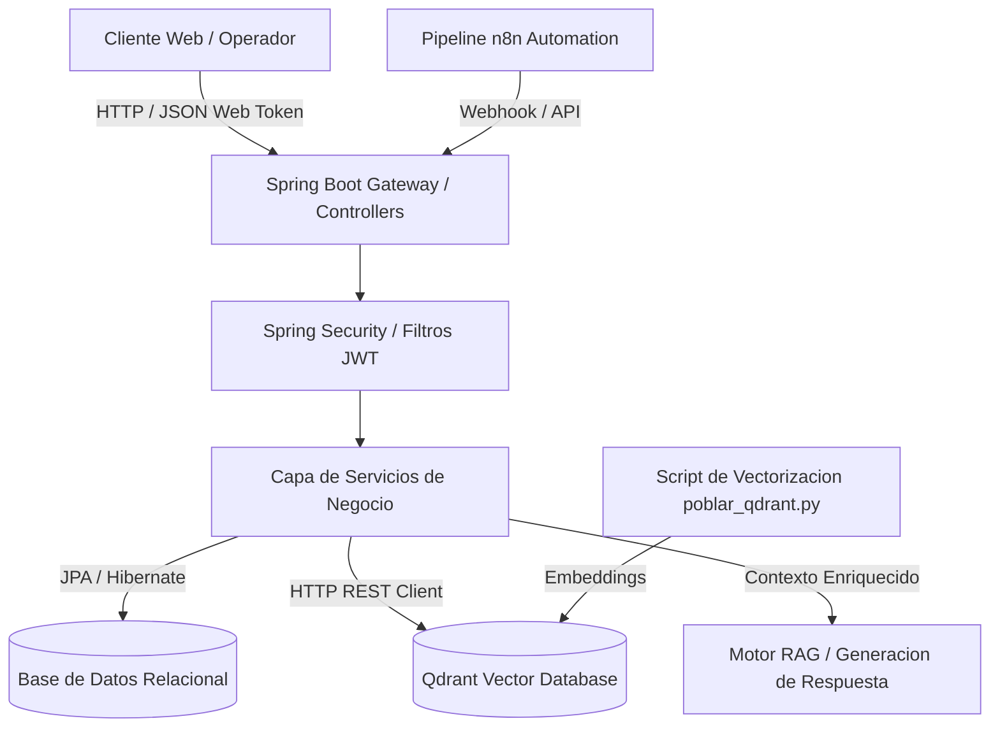

# Inventra RAG - Plataforma de Gestion de Inventarios con Recuperacion Aumentada por Generacion

Sistema empresarial de control de inventarios, gestion de almacenes y busqueda semantica inteligente asistida por modelos de lenguaje y bases de datos vectoriales.

## Resumen Ejecutivo

La administracion de almacenes e inventarios a gran escala enfrenta comunmente desafios asociados a la dispersión de datos tecnicos, discrepancias en nomenclaturas y lentitud en la identificacion de articulos similares o equivalentes. Inventra RAG transforma la experiencia operativa integrando una arquitectura de backend robusta en Spring Boot con una base de datos vectorial Qdrant y flujos de automatizacion en n8n, permitiendo consultas en lenguaje natural mediante tecnicas RAG (Retrieval-Augmented Generation).

## Alcance y Objetivos de Negocio

- Control transaccional de existencias, categorias, almacenes y movimientos fisicos de mercancia.
- Busqueda semantica y recuperacion contextual de productos a partir de consultas ambiguas o descripciones funcionales.
- Seguridad perimetral con autenticacion basada en JSON Web Tokens (JWT) y control de acceso basado en roles (RBAC).
- Orquestacion de flujos de notificacion automatica ante caidas en puntos de reorden y pedidos de abastecimiento.
- Interoperabilidad completa a traves de una API REST documentada bajo el estandar OpenAPI 3.

## Arquitectura del Sistema

Inventra RAG sigue un enfoque arquitectonico desacoplado y orientado a servicios:
1. Nucleo Backend (Spring Boot 4.1, Spring Data JPA, Spring Security).
2. Capa de Base de Datos Relacional y Vectorial (MySQL / PostgreSQL para persistencia transaccional y Qdrant para indices vectoriales).
3. Capa de Orquestacion RAG (n8n para automatizacion de pipelines y poblamiento de embeddings).
4. Capa Frontend Administrativa (Cliente web para operadores y jefes de inventario).

### Diagrama de Flujo Arquitectonico

